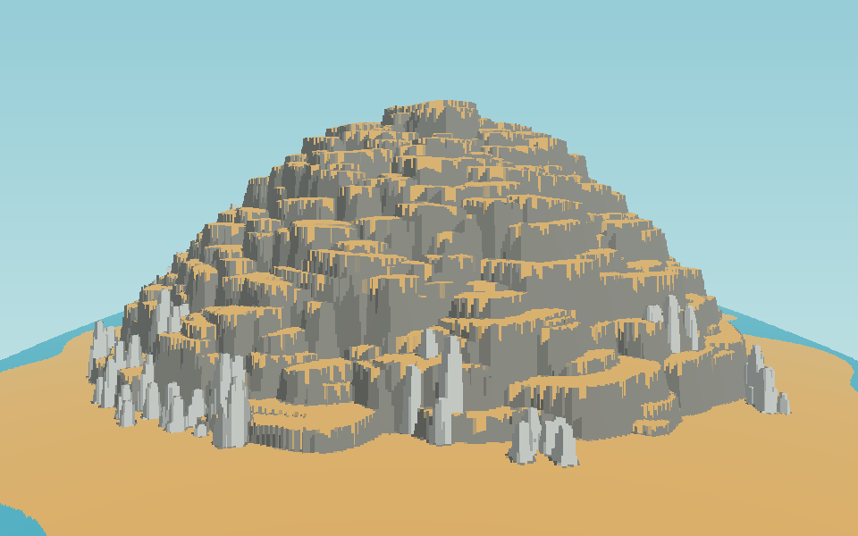

# Studio: come genera la montagna PEAK, e cosa cambia rispetto al nostro generatore

Questo studio parte da una foto del gioco (la montagna della spiaggia vista da lontano) e da ciò
che si osserva giocando. Il codice di PEAK non è pubblico: tutto quello che segue sul loro metodo è
**dedotto dalle immagini**, non confermato. La parte sul nostro generatore invece è certa.

## 1. Cosa si vede nella foto

1. **La montagna è un mucchio di macigni.** Non c'è una superficie continua: si distinguono
   decine di blocchi di roccia grandi 8–20 m, ognuno con la sua forma poliedrica irregolare,
   ruotati in tutte le direzioni e compenetrati l'uno nell'altro.
2. **Gli stessi blocchi si ripetono.** Molti macigni hanno la stessa sagoma con scala e rotazione
   diverse: sono pochi modelli fatti a mano, riusati centinaia di volte.
3. **Il materiale dipende dalla pendenza, non dalla zona.** Dove una faccia guarda in alto c'è
   sabbia; dove è ripida c'è roccia grigia. Il confine segue la forma di ogni singolo blocco, come
   polvere che si posa. Non c'è una fascia "sabbia" e una fascia "roccia".
4. **Ci sono strapiombi e incavi veri.** Tra un macigno e l'altro restano ombre profonde,
   tetti, nicchie: la forma è pienamente tridimensionale.
5. **La sagoma generale è una cupola irregolare, larga alla base.** Un'isola di sabbia bassa,
   poi il mucchio che sale ripido e si stringe. Non è una torre né una scalinata: non si leggono
   "piani" orizzontali regolari.
6. **I punti di riposo nascono da soli.** Le cime dei macigni sono le cenge. Sono a quote tutte
   diverse, quindi i percorsi possibili sono moltissimi e nessuno è disegnato.
7. **Dettagli a gruppi.** Colonne di pietra chiara in ciuffi alla base, palme sulle cime piane,
   cespugli viola, un ponte o tronco sospeso tra due blocchi in alto.

## 2. Il metodo che ne deduco

```
seed ─► sagoma guida del bioma ─► spargimento di macigni prefabbricati ─► materiale per pendenza
     ─► oggetti a regole (su piano / su parete / a gruppi) ─► pezzi speciali fatti a mano
```

- **Sagoma guida** (non visibile): un volume semplice che dice dove deve esserci roccia e a che
  quota. Probabilmente fatto a mano per ogni bioma, forse con qualche variante.
- **Spargimento (kitbashing)**: migliaia di copie di pochi modelli di macigno vengono appoggiate
  sulla sagoma con posizione, rotazione e scala scelte dal seed. È la tecnica più rapida per
  ottenere una montagna credibile, e spiega come sia stato possibile farlo in poche settimane: la
  parte artistica sta in una ventina di rocce ben fatte, il resto è piazzamento.
- **Collisione sui modelli veri**: ci si arrampica sulla geometria dei macigni. Per questo nel
  gioco si può scalare quasi ovunque e gli strapiombi contano.
- **Materiale per pendenza**: un solo shader per tutte le rocce, che mette sabbia (o neve, muschio,
  cenere, a seconda del bioma) dove la normale guarda in alto.
- **Niente percorso disegnato**: con cenge a ogni quota la scalabilità è quasi garantita dalla
  densità stessa dei blocchi. Se c'è un controllo, è probabilmente leggero.

## 3. Dove il nostro generatore è diverso

| | PEAK (dedotto) | Il nostro oggi |
|---|---|---|
| Forma | unione di macigni 3D | heightmap: una quota per ogni punto (x, z) |
| Origine della forma | modelli fatti a mano, sparsi dal seed | funzioni: profilo a salti e cenge, rumore, timbri |
| Strapiombi, incavi | sì | impossibili con una heightmap |
| Aspetto | caotico, a blocchi, ogni punto diverso | regolare: salti paralleli, cenge continue |
| Materiale | dalla pendenza di ogni faccia | deciso dal bioma per cella, più "piano o parete" |
| Punti di riposo | cime dei macigni, a quote casuali | cenge progettate, passaggi (rampa, gradoni, canalone) |
| Vie | emergono da sole, moltissime | 2–3 trovate e, se serve, scavate dal validatore |
| Pianta | isola con il monte al centro, si gira intorno | corridoio: avanti e in salita |

Il punto centrale: **noi descriviamo la superficie, loro accumulano volumi.** Per questo la nostra
montagna, anche resa verticale, continua a sembrare "progettata" (righe orizzontali, pareti
parallele), mentre la loro sembra una frana naturale.

Quello che abbiamo e che resta valido: seed giornaliero, slot di biomi con varianti, falò e
nebbia a tappe, stamina e afflizioni, oggetti, validatore delle vie, stile grafico, erba e alberi.

## 4. Esperimento: funziona davvero?

`tools/study_chunks.py` prova l'idea nel modo più economico, senza toccare il gioco:

```
quota(x, z) = max( isola, max su tutti i blocchi di blocco_i(x, z) )
```

- sagoma guida: una cupola ripida alta 78 m su un'isola di sabbia;
- 874 blocchi a "scatola arrotondata" (superellisse), ruotati, un po' inclinati, più grossi in
  basso, con la cima a ± 3 m dalla sagoma;
- colonne chiare a gruppi alla base;
- colore deciso solo dalla pendenza (piano = sabbia, ripido = roccia), luce a fasce.



Cosa dice il risultato:

- **La sagoma e la "grana" sono quelle giuste.** Mucchio di blocchi, sabbia sulle cime, colonne
  alla base: l'insieme somiglia alla foto molto più del generatore attuale, con 60 righe di logica.
- **Il 37 % della superficie dei blocchi è ripida** (da scalare), il resto sono cime piane: riposi
  ovunque e a quote diverse, come nel gioco originale.
- **Due limiti restano**, ed entrambi vengono dalla heightmap: i blocchi sembrano "tavoli" (cima
  piatta, fianchi verticali) invece di poliedri irregolari, e non ci sono strapiombi né incavi.

## 5. Proposta

Tre passi, dal più semplice al più fedele. Ognuno lascia il gioco funzionante.

### Passo A: mucchio di macigni sulla heightmap (piccolo)
Sostituire nel generatore "profilo a salti e cenge" con "sagoma guida + unione di blocchi",
come nell'esperimento, e il materiale per cella con il materiale per pendenza.
- Restano uguali: fisica, validatore, nebbia, oggetti, erba, mappa.
- Cambiano: `buildLayout` (sagome per bioma invece di profili), la cottura, i materiali.
- I passaggi progettati (rampa, gradoni, canalone) spariscono: le vie emergono dai blocchi e il
  validatore interviene solo dove manca un appoggio.
- Per ogni bioma servono solo parametri: dimensione e forma dei blocchi, quanto sono inclinati,
  cosa si posa in cima (sabbia, muschio, neve, cenere).
- Limite: niente strapiombi, blocchi un po' "a tavolo". Si attenua con blocchi a più falde
  (cima inclinata, spigoli tagliati) e con rumore sui fianchi.

### Passo B: pianta a isola (medio)
Passare dal corridoio a un'isola con il monte al centro, scalabile da ogni lato, con i biomi
impilati come nella foto. I falò stanno sulle spalle del monte tra un bioma e l'altro. Il
validatore funziona già su tutta la griglia, quindi va adattato solo il punto di partenza e di
arrivo di ogni tappa.

### Passo C: macigni 3D veri (grande)
Abbandonare la heightmap: la montagna diventa l'unione di **modelli di macigno** (i tuoi GLB, o
generati) piazzati dal seed, e si arrampica sulla loro geometria.
- Dà strapiombi, incavi, tetti: l'aspetto della foto.
- Va riscritto: collisione e arrampicata su mesh (serve una struttura di accelerazione, ad
  esempio un BVH), validatore su punti campionati della superficie invece che su celle, mappa.
- Servono 15–25 modelli di macigno per bioma con buone forme: è lavoro di asset più che di codice.

### Cosa consiglio
Fare **A subito**: è il cambiamento che dà più somiglianza per meno lavoro, e si vede se la
direzione ti convince. Poi **B**, che cambia il modo di giocare (si gira intorno al monte). **C**
solo se dopo A e B gli strapiombi mancano davvero: è una riscrittura della fisica.

## 6. Domande aperte

1. **Corridoio o isola?** Nella foto il monte si scala da ogni lato. Vuoi quello (passo B), o
   preferisci tenere "avanti e in salita"?
2. **Strapiombi:** sono importanti per le tue meccaniche di movimento? Se sì, conviene puntare al
   passo C e non investire troppo in A.
3. **Macigni:** se si arriva a C, li generi tu come hai fatto per gli altri asset, o li genero io
   dal codice (poliedri irregolari smussati)?

## 7. Esito

Si è scelto il passo C insieme al B: isola scalabile da ogni lato, macigni 3D veri generati dal
codice (poliedri convessi, 8 modelli riusati ≈ 3300 volte), fisica su campo di distanza con
strapiombi, cenge e vie che emergono dalle facce dei macigni. La descrizione del sistema attuale è
nel README principale, sezione 2.
